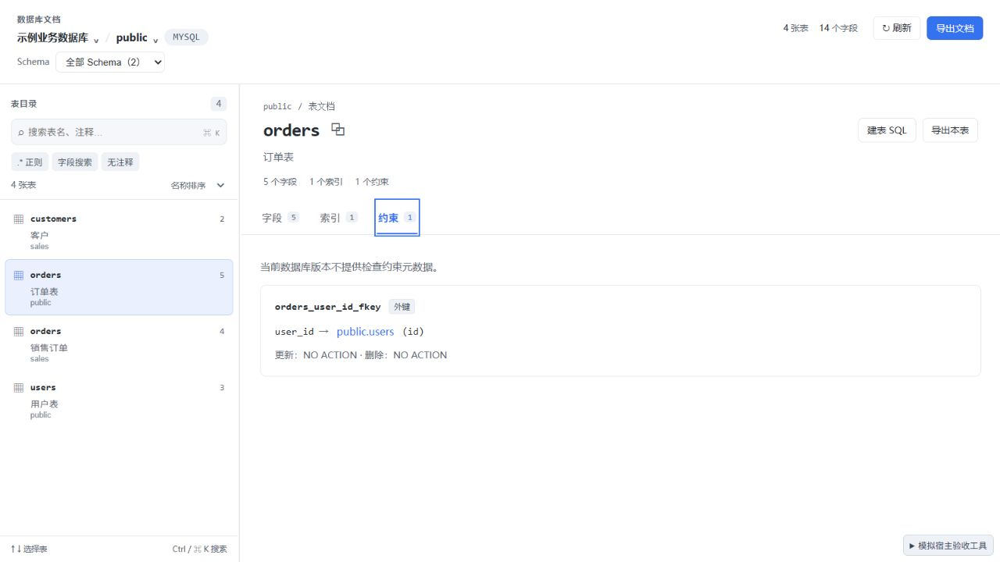

# 0.2.1 检查约束兼容修复

日期：2026-09-29。

## 问题与处理

旧版 MySQL 缺少 `INFORMATION_SCHEMA.CHECK_CONSTRAINTS`，直接查询会返回 `ERROR 1109 (42S02): Unknown table 'check_constraints' in information_schema`。[MySQL 官方说明](https://dev.mysql.com/blog-archive/mysql-8-0-16-introducing-check-constraint/)介绍了 8.0.16 引入的 CHECK 约束功能和元数据，之前的版本只解析并忽略相应语法。

0.2.1 先使用已存在的 `INFORMATION_SCHEMA.TABLES` 检测系统表是否存在：

- 不存在时不发送检查约束 SQL，继续显示字段、索引和外键；约束页及 Markdown 文档注明「当前数据库版本不提供检查约束元数据」。
- 存在时正常读取检查约束；查询失败继续提示，授权拒绝继续上抛。
- 检测按宿主桥、连接和数据库隔离，最多缓存 8 份；并发导出复用在途检测，检测失败不缓存。关闭并重新打开工作台可重置能力检测。

无需启用 debug SQL diagnostics 来解决这个兼容问题。

## 验证

| 检查 | 结果 |
| --- | --- |
| `npm test` | 16 个文件、134 个用例通过 |
| `npm run check` | 0 errors、0 warnings |
| `npm run build` | 成功，输出宿主重载标记 |
| `dbx-plugin package .` | 生成 0.2.1 universal 未签名候选包 |
| `git diff --check` | 通过 |

新增回归覆盖系统表缺失、并发检测合并、支持版本的 CHECK 内容、连接/库隔离、真正的 SQL 错误、检测失败恢复、授权拒绝恢复，以及导出能力说明。

DBX-MCP 只读核验现有 TEST 连接 `tongxin_hospital`：版本 `5.7.44-txsql-log`，检查约束系统表存在数量为 0。没有修改数据库或查询业务行。

浏览器使用 `?mysql57=1&table=orders&schema=public` 模拟缺失系统表：正常显示字段和索引，约束页保留外键并显示版本说明，没有「检查约束未能读取」提示，控制台没有 error / warn。

## 安装与边界

安装 `dist/com.sazs.dbdoc-0.2.1-universal.dbxp` 替换 0.2.0，关闭并重新打开数据库文档工作台。

真实 0.2.1 桌面插件安装后的界面尚未现场验收；支持 CHECK 的 MySQL / MariaDB 实例尚未实际联调，对应分支已通过回归测试。此前的原生保存对话框等未覆盖项目仍见 [0.2.0 验收记录](verification-0.2.0.md)。
