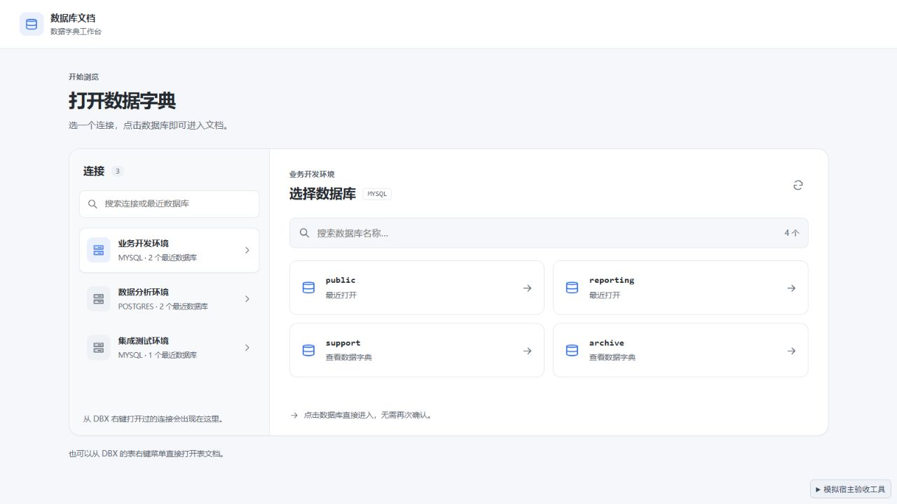
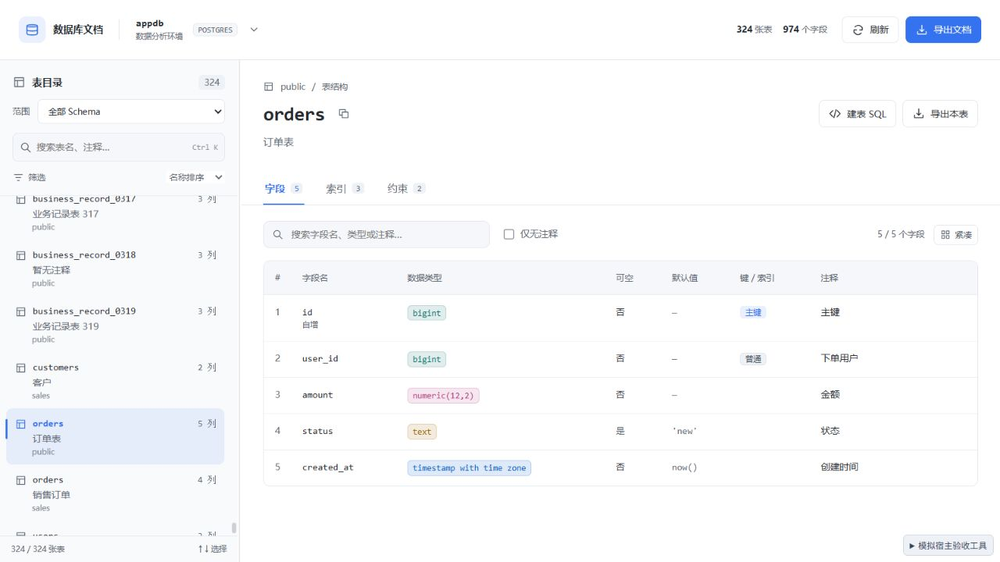
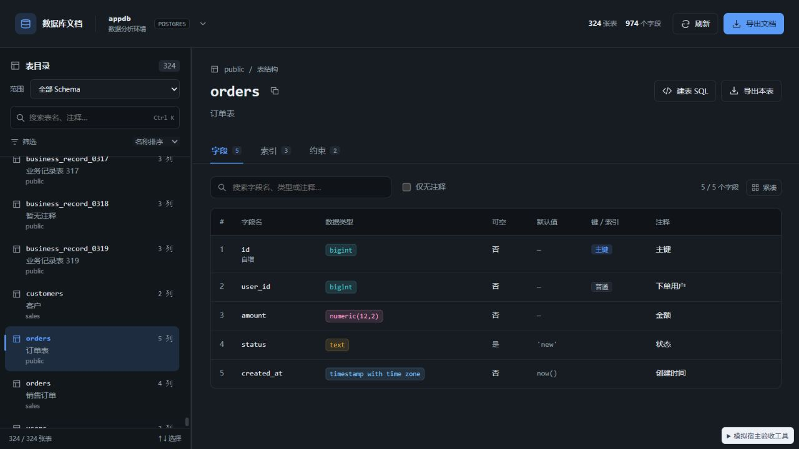
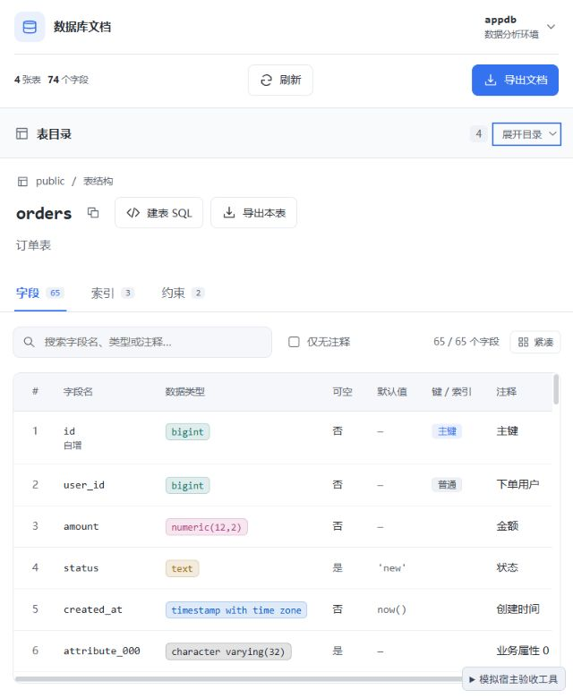

# 0.3.0 界面与交互验收

日期：2026-09-29。截图使用本地模拟宿主和示例元数据。

## 改动

- 连接与数据库合并在同一页。左侧按连接归组，右侧展示数据库，点击数据库直接打开文档；连接和数据库均可搜索。
- 工作台只有一个切换入口。选择器覆盖在工作台上，取消或重新选择当前库时保留当前表、搜索和浏览位置，并恢复键盘焦点。
- 数据库列表合并历史和实时结果，历史数据库无需等待列表完成即可打开。列表读取失败保留原因和重试入口；较慢的旧连接响应不覆盖新的选择。
- MySQL / SQL Server 的连接上下文未指定数据库时，直接进入合并页面。只读取选中的连接，不静默使用其他数据库，也不后台探测历史连接。
- 顶部、目录、详情、空状态、SQL 和导出弹窗使用统一图标、按钮、边框、间距和明暗主题。Schema 范围移到目录，高级筛选默认收起并显示启用数量。
- 字段列表单独滚动，固定表头，支持紧凑密度和键盘滚动；窄窗口可收起目录，快捷键会展开目录并聚焦搜索。
- 宿主重复上下文不覆盖插件内的资源选择，宿主上下文真正变化时仍会定位新表。读取失败后的重试保留当前连接。
- 保留 0.2.1 的 MySQL 5.7 检查约束能力检测。

## 自动检查

| 检查 | 结果 |
| --- | --- |
| `npm run check` | 0 errors、0 warnings |
| `npm test -- --maxWorkers 1 --minWorkers 1` | 17 个文件、141 个用例通过，无未处理错误 |
| `npm run build` | 成功，输出 `DBX_UI_BUILD_SUCCESS` |
| `dbx-plugin package .` | 生成 0.3.0 universal 未签名候选包 |
| `git diff --check` | 通过 |

Windows 并行测试首次遇到临时文件 `EBUSY`；使用单 worker 完整执行后通过。新增用例覆盖连接归组、当前上下文优先级、数据库隔离、搜索、历史与实时列表合并，以及列表读取错误和授权拒绝。

## 浏览器验收

| 场景 | 观察结果 |
| --- | --- |
| 无上下文打开 `?picker=1` | 显示 3 个最近连接，目录、详情、探测和数据库列表查询均为 0 |
| 选择 MySQL 连接 | 同页显示历史与实时数据库；搜索 `report` 只显示 reporting |
| `?picker=1&databases=180` | 共 184 个数据库；右侧列表独立滚动，搜索 domain_179 为 1 / 184，无页面横向溢出 |
| 慢 MySQL 连接后立即选择 PostgreSQL | 延迟响应返回后仍显示 PostgreSQL 的 appdb / events |
| 点击 appdb | 直接进入文档，没有额外确认步骤 |
| 切换入口后按 Escape / 重新选择 appdb | 当前 orders、目录关键词 orders 和字段关键词 amount 保留，焦点回到切换入口 |
| `?connectionOnly=1&dbfail=1` | 同页显示读取失败和原因；恢复后原地重试显示 4 个数据库，目录与详情查询仍为 0 |
| 324 张表的大目录 | 当前视口附近渲染 11 行，行高 72px，表右键定位 orders 正确 |
| 插件内切到另一连接，再发重复宿主上下文 | 保留新的连接与数据库；随后宿主切到 sales.orders 时定位正确 |
| 65 个字段 | PageDown 后滚动约 315px，表头仍位于滚动容器顶部；紧凑按钮正确切换 |
| 640 × 780 窗口 | 收起目录后目录约 55px，字段滚动区约 338px；Ctrl K 展开目录并聚焦搜索 |
| 400 × 800 选择页 | 连接与数据库上下排列，页面宽度无横向溢出 |
| 字段搜索姓名 | 结果为 users 并显示字段匹配，当前 orders 详情保留 |
| Schema 筛选 sales 后从顶部导出 | 默认当前 Schema，只生成 sales 的 orders / customers 两张表；保存取消后保留 Markdown 和再次保存入口 |
| SQL 弹窗复制 | 显示已复制反馈，可从右上角关闭并返回工作台 |
| `?mysql57=1&table=orders&schema=public` | 保留字段、索引和外键；约束页显示版本能力说明，不出现 CHECK_CONSTRAINTS 读取错误 |
| 明暗主题 | 布局及控件颜色正确，验收页面控制台无 error / warn |

## 界面

## 交付与边界

候选包：`dist/com.sazs.dbdoc-0.3.0-universal.dbxp`。安装覆盖旧版本后，关闭并重新打开数据库文档工作台。

发行包仅包含 manifest、图标、构建后的 UI 和校验文件，不含模拟宿主、截图、源码或测试工具；包内校验和及 artifact metadata 已核对。

本轮未执行真实 DBX 桌面插件安装验收。真实保存对话框、宿主授权流程及多连接切库仍需在安装后的 DBX 中确认。连接列表来自当前上下文和最近使用记录；宿主没有连接枚举接口。PostgreSQL 只展示当前或已知数据库，切库需要已有对应会话。

此前元数据与兼容性验证见 [0.2.0 验收记录](verification-0.2.0.md) 和 [0.2.1 兼容修复](verification-0.2.1.md)。
