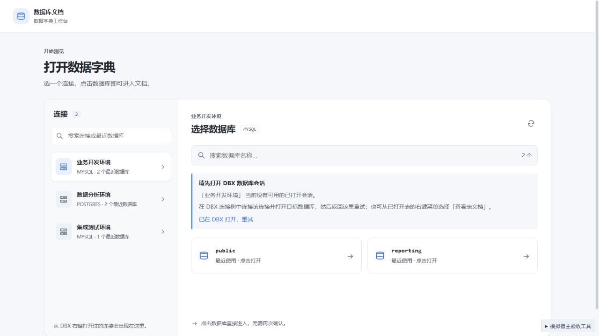
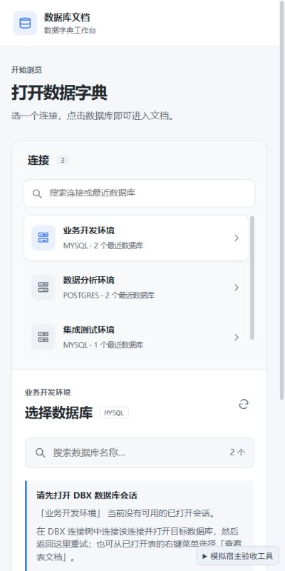

# 0.3.1 数据库会话修复验收

日期：2026-09-29。截图与浏览器检查使用本地模拟宿主，未安装至真实 DBX。

## 问题与修复

用户报告数据库列表提示 `Connection is not open`。依据 [DBX 插件开发文档](https://dbxio.com/cn/docs/plugin-development)，插件查询只能复用宿主已打开的连接和数据库会话；指定的数据库没有对应会话时拒绝请求。插件 SDK 没有连接或重连接口。

源码中发现两处可能把请求发到旧数据库的路径：

- 合并选择页用最近使用记录中的第一个库读取列表，该库的会话可能已经关闭。现在只采用同一连接的当前上下文；上下文未指定库时使用连接默认会话，历史库名只用于展示。
- 表上下文同时含连接摘要的默认库与实际数据库时，连接摘要曾覆盖资源路径。现在数据库、Schema 和表优先采用实际资源上下文，缺失时才采用连接摘要。

点击数据库时，先对精确目标执行只读 `SELECT 1`，通过后才切换文档。失败保留选择页及原文档，提示具体连接与目标库、DBX 中的恢复步骤，并可原地重试。会话校验与列表查询使用同一请求序号；切换连接、取消或关闭选择器使旧响应失效。授权拒绝仍单独处理。

## 自动检查

| 检查 | 结果 |
| --- | --- |
| `npm run check` | 0 errors、0 warnings |
| `npm test -- --maxWorkers 1 --minWorkers 1` | 17 个文件、149 个用例通过 |
| 新增回归 | 资源上下文优先级、默认会话与目标会话请求、关闭与拒绝错误不回退其他数据库 |
| `npm run build` | 成功，输出 `DBX_UI_BUILD_SUCCESS` |
| `dbx-plugin package .` | 生成 0.3.1 universal 未签名候选包 |
| 包校验 | artifact SHA-256、包内 5 个文件校验和及构建入口一致 |
| `git diff --check` | 通过 |

发行包 66,444 字节，SHA-256 为 `49a804bab25e634e81aa6245d33d7db481279b059d0fda915a94b0c3a6b137ba`。仅包含 manifest、图标、构建后的 UI 与 checksums，不包含模拟宿主、源码、截图或测试工具。

## 浏览器检查

| 场景 | 观察结果 |
| --- | --- |
| 连接会话关闭 | 合并页显示「请先打开 DBX 数据库会话」、恢复步骤和重试；保留两个最近数据库 |
| 模拟恢复连接后重试列表 | 原地出现四个数据库；列表查询计数为 2，目录与详情查询均为 0 |
| 默认会话打开、历史 public 库会话关闭 | 数据库列表仍显示四个库；点击 public 后原地提示精确目标，目录与详情查询均为 0，确认查询为 1 |
| 恢复 public 会话后重试 | 进入业务开发环境的 public 文档，显示表清单与字段 |
| 确认查询延迟 1.3 秒时切换连接 | 延迟完成后仍选中数据分析环境，保持选择页，未跳到旧库 |
| appdb 文档切换到关闭的 reporting 库 | 留在选择器；返回后仍为 appdb / public.orders，搜索词 orders 保留，焦点回到切换按钮 |
| 已指定数据库但会话关闭的直接入口 | 空状态显示具体连接、数据库及恢复步骤，提供重试与切换入口 |
| 400 × 800 窗口 | 连接与数据库上下布局，恢复提示换行正常，文档宽度为 400，无横向溢出 |
| 控制台 | 验收页面无 error / warn |

## 交付与边界

候选包：`dist/com.sazs.dbdoc-0.3.1-universal.dbxp`。升级后关闭并重新打开数据库文档工作台。

此修复消除插件误用历史库与默认库的路径，并改善真实关闭会话时的操作反馈；不会替用户创建数据库会话。若 DBX 中目标会话尚未打开，需要先连接并打开该数据库，再返回重试，或从已打开表右键进入。真实 DBX 安装与用户报错连接的恢复未在本轮验证。
