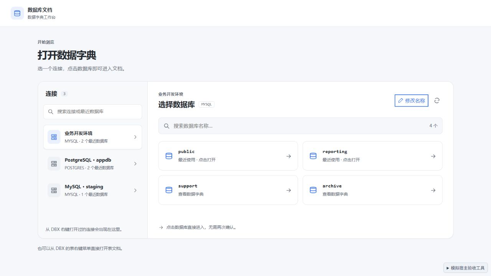
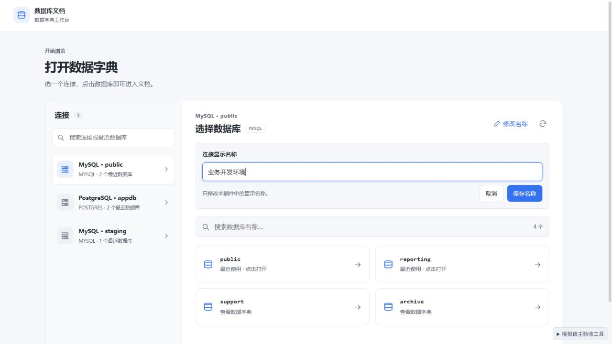

# 0.3.2 连接名称验收

日期：2026-09-29。浏览器验收及截图使用本地模拟宿主。

## 问题与证据

用户报告已建立连接，切换页仍显示「未命名连接」。DBX-MCP 只读检查确认配置中的连接具有名称。依据 [DBX 插件开发文档](https://dbxio.com/cn/docs/plugin-development)，表右键上下文提供对象身份，连接右键上下文才提供连接名称；建立连接本身不能替代该上下文传递。

源码存在四条名称丢失路径：表入口的空名称覆盖同连接已有记录；名称只在目录成功读取后保存；仅名称变化的上下文未持久保存；展示层把混合大小写和数字的长英文名称误判成机器 ID。

## 修复

- 在连接入口进入引导页或查询失败之前，保存可用的连接名称；表入口从同连接的记录补全名称和类型，数据库、Schema 和表保持当前上下文的实际值。
- 名称按连接维护，更新时同步到同连接的全部已知库记录。空值、占位名和连接 ID 不覆盖真实名称；旧记录中可恢复的名称从最新有效记录补齐。
- 同一资源只更新名称时立即更新显示并保存。存储读取期间到达的新名称优先于旧快照，较晚的旧结果不盖回旧名称。
- 串行执行历史记录的读、改、写，避免并发进入或命名时相互覆盖；一次写失败不会阻塞后续操作。
- 名称缺失时使用类型与库名；没有库名时以序号区分，不再统一显示「未命名连接」。长英文名称原样展示，明确的连接 ID 不展示。
- 提供「修改名称」，保存至插件存储；不修改 DBX 的连接配置。空输入有校验，失败保留原名称和草稿，可重试；取消及保存后恢复键盘焦点。

## 自动检查

| 检查 | 结果 |
| --- | --- |
| `npm run check` | 0 errors、0 warnings |
| `npm test -- --maxWorkers 1 --minWorkers 1` | 17 个文件、161 个用例通过 |
| 新增回归 | 空名称继承、跨库改名、旧记录修复、长英文名称、上下文补全不串库、并发保存与写失败恢复、连接名称字段优先级 |
| `npm run build` | 成功，输出 `DBX_UI_BUILD_SUCCESS` |
| `dbx-plugin package .` | 生成 0.3.2 universal 未签名候选包 |
| 包校验 | artifact SHA-256、包内 5 个文件校验和及构建入口一致 |
| `git diff --check` | 通过 |

发行包 68,409 字节，SHA-256 为 `cae1b4a5d22ef90f525079c0ed73fc2593945e83c0e82301f32b3fa66269c04c`。包内仅包含 manifest、图标、发行 UI 和 checksums。

## 浏览器验收

| 场景 | 观察结果 |
| --- | --- |
| 表入口不带名称 | 工作台和选择器均显示同连接已有的「数据分析环境」 |
| 全部历史名称为空 | 显示 MySQL · public、PostgreSQL · appdb、MySQL · staging |
| 为旧记录补充「业务开发环境」 | 左侧连接行与右侧标题同步更新；切到 reporting 并重新打开选择器，名称保持 |
| 后续表入口仍不带名称 | 保留「业务开发环境」；宿主改名后再收到无名表入口，保留新名称 |
| 保存故障 | 显示具体存储失败，原名称与输入保留；模拟恢复后可保存 Development MySQL |
| 修改名称的查询计数 | 前后均为目录 0、详情 0、探测 0、数据库列表 1，命名不增加数据库请求 |
| 存储写失败但旧名称可读取 | 表入口仍显示已有名称 |
| Health_MySQL_2026_TEST | 正常显示在连接行与右侧标题 |
| 历史读取延迟 300ms，名称事件在 80ms 到达 | 最终显示「重命名的业务连接」，旧快照不覆盖新名称 |
| 400 × 800 窗口 | 名称编辑正常，文档宽度 400，无横向溢出；Escape 取消编辑并保留选择页 |
| 控制台 | 无 error / warn |

## 交付与边界

候选包：`dist/com.sazs.dbdoc-0.3.2-universal.dbxp`。升级后关闭并重新打开工作台。旧记录可直接补充显示名称，或从 DBX 对应连接的右键入口打开文档以同步实际名称。

名称来自当前上下文与最近记录；当前纯前端插件 SDK 没有枚举全部连接名称的接口。首次从表入口进入且没有历史名称时，无法由连接 ID 推断用户设置的名称，因此提供可识别的默认展示和编辑入口。最近记录容量仍为 8 个连接与数据库入口。

本轮未安装至真实 DBX 验收；DBX-MCP 连接名称检查与浏览器模拟不等同于原生插件安装验证。
