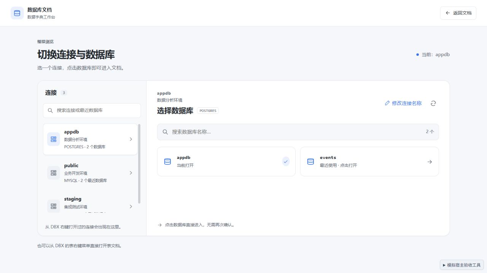
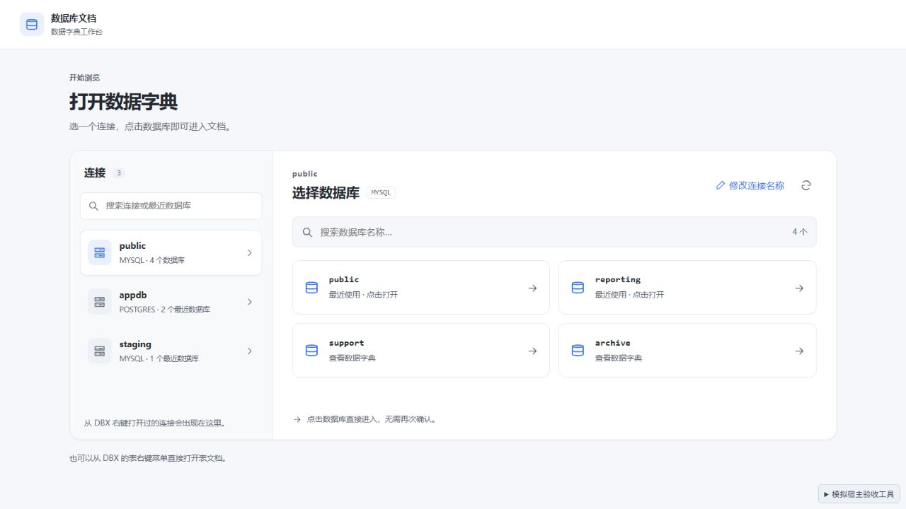
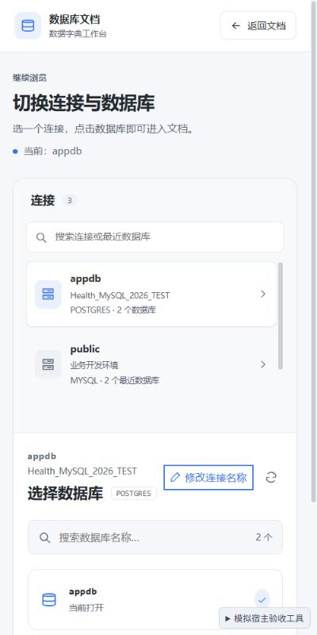

# 0.3.3 库名展示验收

日期：2026-09-29。浏览器验收及截图使用本地模拟宿主。

## 修复

切换入口、连接列表和选中连接的主标题优先显示真实库名：当前上下文库优先，其次采用该连接的最近库；首次没有记录时，可采用实时读取的库名。连接名称显示为辅助信息，数据库类型单独显示。

表上下文中的通用 `name`、`title`、`label` 等于表名时，不再将它们保存为连接名称；明确的连接名称字段仍正常读取。表名不参与连接与数据库标题命名。

真实库名不再按机器 ID 的外形过滤，避免长英文数字名称或十六进制形式名称被隐藏。当前库和最近记录均保留实际名称。修改连接名称只更新辅助信息，搜索仍支持连接名称、类型及库名。

## 自动检查

| 检查 | 结果 |
| --- | --- |
| `npm run check` | 0 errors、0 warnings |
| `npm test -- --maxWorkers 1 --minWorkers 1` | 17 个文件、164 个用例通过 |
| 新增回归 | 库名优先级、表名排除、辅助信息去重、通用上下文名称排除、长英文数字与十六进制库名保存回读 |
| `npm run build` | 成功，输出 `DBX_UI_BUILD_SUCCESS` |
| `dbx-plugin package .` | 生成 0.3.3 universal 未签名候选包 |
| 包校验 | artifact SHA-256、包内 5 个文件校验和、manifest 版本及构建入口一致 |
| `git diff --check` | 通过 |

发行包 68,702 字节，SHA-256 为 `4f49cc9a7d9b8f329d272a14ca1a3075e75ffa306f1742ec0985195343ddbd78`。包内仅包含 manifest、图标、发行 UI 和 checksums，共 6 个文件；模拟宿主不进入发行包。

## 浏览器验收

| 场景 | 观察结果 |
| --- | --- |
| 历史记录没有连接名称 | 主标题分别显示 public、appdb、staging，类型与数量显示在下方 |
| 表上下文 name 与 table 同为 orders | 工作台切换入口显示 appdb；选择页主标题仍为 appdb，已有数据分析环境名称作为辅助信息 |
| 选择 events | 工作台主标题更新为 events，连接辅助名称仍为数据分析环境 |
| 首次连接入口，没有历史库名 | 实时读取后左侧与右侧标题显示 public，左侧显示 4 个数据库 |
| 将连接显示名称改为 Health_MySQL_2026_TEST | 主标题保持 appdb，辅助名称更新为输入值 |
| 400 × 800 窗口 | 库名与长连接名称可辨认；文档宽度 400，无横向溢出 |
| 最终预览控制台 | 无 error / warn |

## 交付与边界

候选包：`dist/com.sazs.dbdoc-0.3.3-universal.dbxp`。安装升级后关闭并重新打开数据库文档工作台。

在尚未取得任何库名时，使用已有连接名称；两者均缺失时以序号区分，等待有效上下文或实时列表。库名展示调整不更改数据库会话的选择与只读查询目标。

本轮完成单元回归、构建、包校验和浏览器模拟验收，未安装至真实 DBX 验收。
