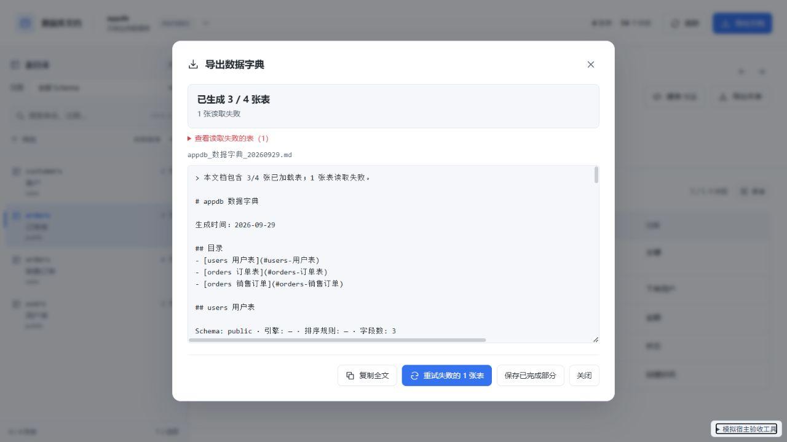
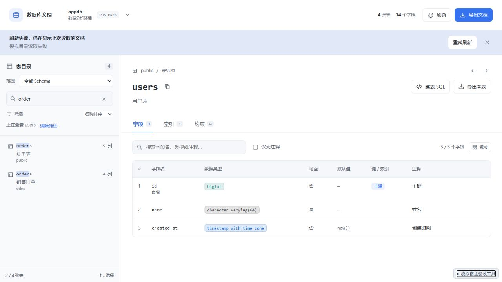
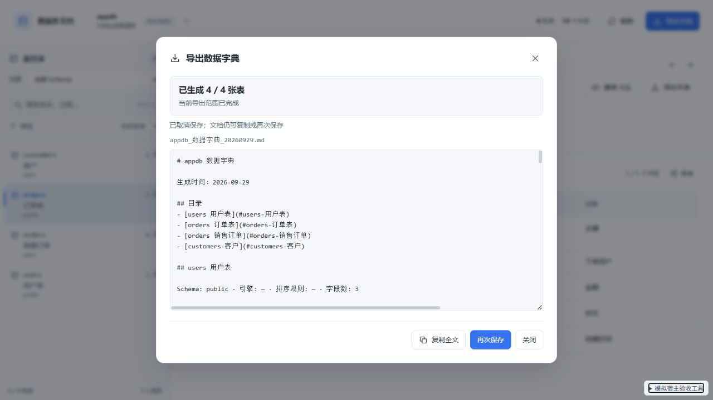
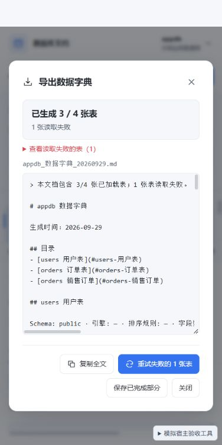

# 0.4.0 浏览与恢复验收

日期：2026-09-29。浏览器验收及截图使用本地模拟宿主，不代表真实 DBX 安装验收。

## 改进

- 表浏览支持返回、前进及 `Alt + ← / →`，恢复此前的字段、索引或约束页签。关联表链接打开目标表字段，同库表右键上下文保留目录搜索和浏览历史。
- 已打开文档的目录刷新遇到临时故障时保留当前表、字段和搜索，显示可重试、可关闭的提示。首次加载失败仍显示错误页；数据访问授权被拒绝时隐藏文档并显示授权恢复页。
- 导出固定初始连接、数据库和表范围，保留已完成结果，仅重试失败或尚未读取的表。停止后可继续生成，部分结果需明确选择保存。连接关闭或授权拒绝会停止派发后续表查询，恢复后可继续。

## 自动检查与包校验

| 检查 | 结果 |
| --- | --- |
| `npm run check` | 0 errors、0 warnings |
| `npm test -- --maxWorkers 1 --minWorkers 1` | 19 个文件、176 个用例通过 |
| 新增回归 | 浏览历史及分支、同名跨 Schema 表、结果合并与范围隔离、仅重试缺失表、会话关闭及授权拒绝停止队列 |
| `npm run build` | 成功，输出 `DBX_UI_BUILD_SUCCESS` |
| `dbx-plugin package .` | 生成 0.4.0 universal 未签名候选包 |
| 包校验 | artifact SHA-256、包内 5 个文件校验和、manifest 对象与版本一致；图标和 UI 与当前发行构建逐字节一致 |
| `node --check repro/mock-host.js` | 通过 |
| `git -c core.safecrlf=false diff --check` | 通过 |

候选包：`dist/com.sazs.dbdoc-0.4.0-universal.dbxp`，71,157 字节。SHA-256：`1908bf3c4e29eb1ed6afd80c4cf191dfb80139ac9efec5489c4f314134994adc`。

包内仅包含 manifest、图标、发行 UI 和 checksums，共 6 个文件。入口引用 `index-Czo9LVA9.js`、`index-Dt8uSscI.css`；模拟宿主、测试及验收文档不进入发行包。

## 浏览器验收

| 场景 | 观察结果 |
| --- | --- |
| 部分导出失败 | 生成 3 / 4 张表，保留失败明细，显示「重试失败的 1 张表」与「保存已完成部分」，未自动保存 |
| 重试失败表 | 每次只增加 `sales.customers` 的 4 条元数据查询；其余成功表计数不变。恢复后补全至 4 / 4，清除失败提示，保留两个 Schema 的 orders |
| 补全后保存取消 | Markdown 完整保留，可再次保存 |
| 全部表读取失败 | 保留 4 张表的失败明细与重试入口；恢复元数据后补全至 4 / 4 |
| 停止与继续 | 12 张表生成期间停止，显示「正在停止…」并禁用重复停止；当前并发请求结束后保留 2 / 12，继续剩余 10 张至 12 / 12 |
| 会话关闭 | 12 张表导出只尝试已派发的 public.orders、public.users，显示 2 个失败及继续剩余 12 张入口；其余 10 张未派发。模拟打开会话后补全至 12 / 12 |
| 浏览历史 | 搜索 order 后，从 public.orders 的约束跳到 public.users 字段；返回恢复 orders 约束页签，前进恢复 users 字段页签，目录搜索保持 order，缓存有效时未新增详情查询 |
| 键盘返回、前进 | `Alt + ← / →` 恢复对应表及页签 |
| 旧响应晚到 | users 请求延迟 1.8 秒，确认请求已派发后返回 orders；迟到结果未覆盖 orders 及其约束页签 |
| 刷新故障恢复 | 当前 users 字段和搜索保持可见，显示行内提示；恢复目录后重试成功并保留选择 |
| 刷新期间表右键 | 延迟 300 毫秒的刷新期间收到 sales.orders 上下文，完成后仍显示 sales.orders 的 4 个字段；搜索保持 order，目录只增加一次刷新查询，返回恢复 public.orders |
| 授权拒绝 | 刷新后显示「数据访问未授权」，表文档区域数量为 0；恢复授权后重新加载 |
| 首次目录失败 | 显示「文档读取失败」，表文档区域数量为 0 |
| 长库名导出 | 模拟保存成功，宿主收到 `Health_MySQL_2026_TEST_数据字典_20260929.md`；文档标题保留真实库名 |
| 400 × 800 窗口 | 部分导出按钮正常换行，弹窗 clientWidth 与 scrollWidth 均为 366，无横向溢出 |
| 最终会话恢复预览控制台 | 无 error / warn |

## 交付与边界

浏览历史最多 50 个位置，仅保存在当前数据库的页面会话中。切换数据库或重新启动加载会重置历史。同一表重复访问不增加历史，返回后打开其他表会清除前进分支。

导出进度保存在当前弹窗内，关闭弹窗后不持久保留。停止无法取消已经发送给 SDK 的查询，需等待当前并发请求完成。补全后的文档需保存更新文件；已保存的部分文件不会自动覆盖。所有元数据读取使用只读查询。

本轮完成单元回归、构建、发行包校验和浏览器模拟验收。未安装至真实 DBX，未验证原生保存对话框及真实宿主权限流程。长库名场景使用 PostgreSQL 模拟元数据，不代表 MySQL 实机验证。
