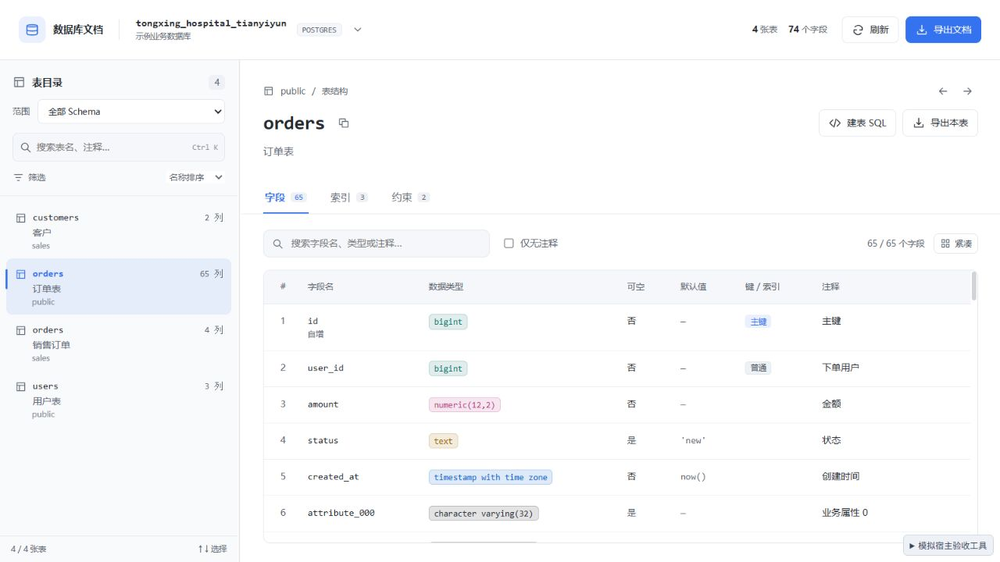
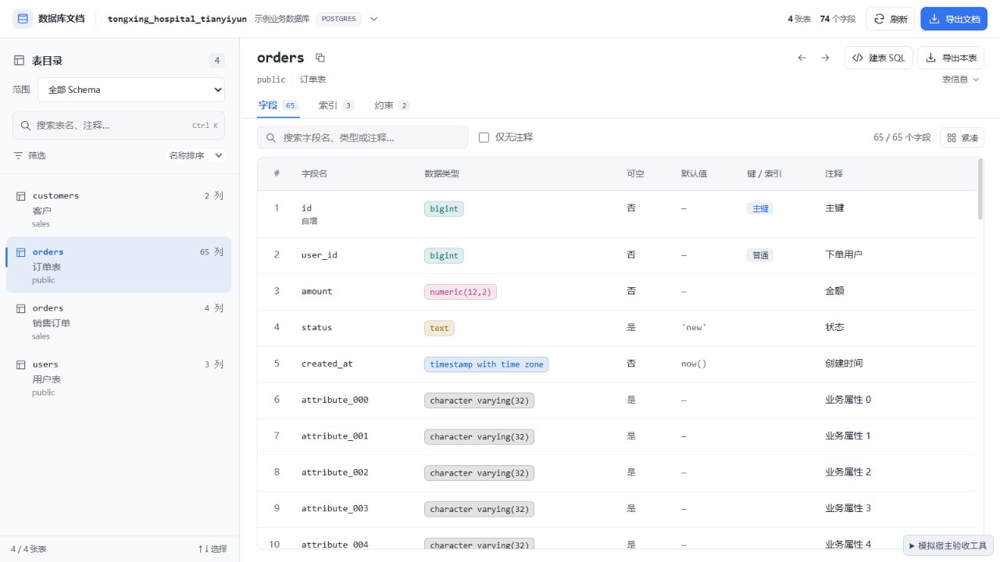
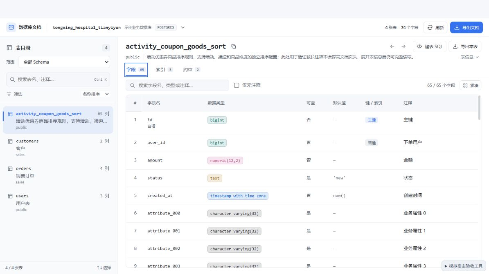
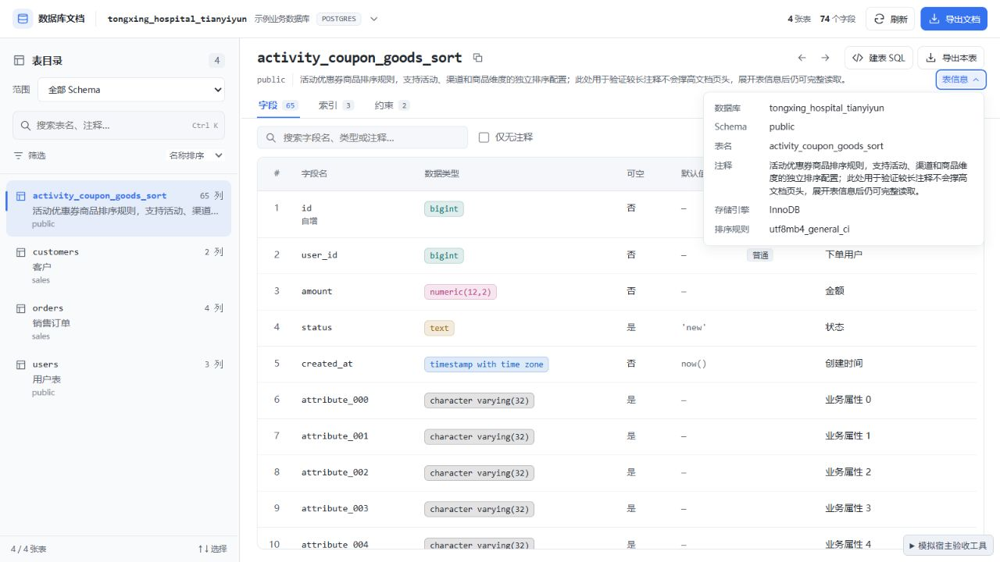
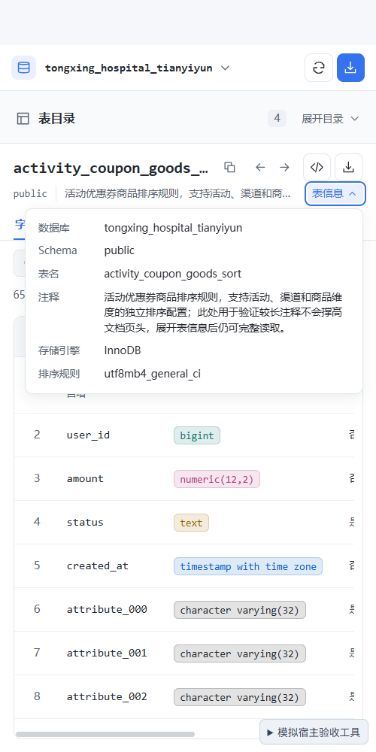

# 0.4.1 紧凑文档页验收

日期：2026-09-29。针对文档页顶部和基础信息占用过多的问题，压缩固定区域，为字段列表增加空间。

## 调整

- 全局顶栏收为单行：库名、辅助连接名称、类型和操作横向排列，减少上下内边距。窄窗口保留库名，刷新和导出使用有名称及悬浮提示的图标按钮。
- 移除独立「表结构」面包屑行。表名、复制、返回 / 前进、建表 SQL 和导出本表排列在同一行。
- 注释使用单行摘要，Schema 与当前库相同时不重复展示。长表名和注释不会撑高标题区，完整内容可从「表信息」查看。
- 存储引擎、排序规则等完整属性收进「表信息」浮层；展开不改变字段区高度。支持再次点击、Escape、点击其他区域收起，切换表时自动收起。
- 缩小页签、字段搜索栏和各区域间距，字段行保持原有默认字号与密度。

## 空间测量

同一 1280 × 720 浏览器视口、同一 PostgreSQL 模拟数据库、public.orders 的 65 个字段，使用 DOM 实际边界测量，单位为 px：

| 区域 | 调整前 | 调整后 |
| --- | ---: | ---: |
| 全局顶栏高度（含边框） | 76.8 | 48.8 |
| 表基础信息区高度 | 156.5 | 71.5 |
| 页签区高度 | 41.2 | 31.6 |
| 字段表格距页面顶部 | 345.3 | 200.7 |
| 第一条字段数据距页面顶部 | 389.4 | 244.8 |
| 字段表格可用高度 | 350.7 | 503.3 |

表格上移约 145px，可用高度增加约 153px（约 44%）。测量结果对应此模拟视口；实际宿主字号、窗口、提示信息和目录布局会影响数值。

## 浏览器验收

| 场景 | 结果 |
| --- | --- |
| 展开 / Escape 收起属性 | 展开后完整显示数据库、Schema、表名与注释；基础信息高度仍为 71.5，字段表格位置仍为 200.7 |
| 长表名和长注释 | activity_coupon_goods_sort 及长中文注释不增加标题区高度；完整文本和模拟 InnoDB / utf8mb4_general_ci 属性可从浮层读取 |
| 点击页签收起属性 | 浮层关闭，字段列表不重新排列 |
| 400 × 800 窄窗口 | 顶栏仍约 49px，页面 scrollWidth 为 400；收起目录后表信息区仍为 71.5，长表名省略显示但可复制和展开读取 |
| 窄窗口属性浮层 | 左边界 26，右边界 386，clientWidth 与 scrollWidth 均为 358，无横向溢出 |
| 建表 SQL | 图标按钮可打开对应表的 SQL 对话框 |
| 导出本表 | 图标按钮可打开导出对话框，当前表范围已选中 |
| 外键与返回 | 跳转 public.users 字段后返回，恢复 activity_coupon_goods_sort 和选中的约束页签 |
| 切换连接与数据库 | 紧凑入口正常打开选择页，返回文档恢复原表 |
| 控制台 | 最终浏览器 error / warn 为空 |

## 自动检查与交付

| 检查 | 结果 |
| --- | --- |
| `npm run check` | 0 errors、0 warnings |
| `npm test -- --maxWorkers 1 --minWorkers 1` | 19 个文件、176 个现有用例通过 |
| `npm run build` | 成功，输出 DBX_UI_BUILD_SUCCESS |
| `node --check repro/mock-host.js` | 通过 |
| `git -c core.safecrlf=false diff --check` | 通过 |
| `dbx-plugin package .` | 0.4.1 universal 未签名候选包 |
| 包校验 | artifact SHA-256、包内 5 个文件校验和及版本一致；图标和 UI 与当前构建逐字节一致 |

候选包：`dist/com.sazs.dbdoc-0.4.1-universal.dbxp`，72,151 字节。SHA-256：`0db33517978e5899d890d4e9592e26f2d0004e7dfea1f7c2c67949c5ca9a6434`。

包内共 6 个文件，仅包含 manifest、图标、UI 和 checksums；入口引用 `index-CzqiXJoo.js`、`index-8kA9eRF5.css`。模拟宿主、测试和验收截图不进入发行包。

本轮浏览器验证采用本地模拟宿主。存储引擎和排序规则参数仅用于验证属性展示，不代表 MySQL 实机验证。未安装至真实 DBX；升级后需关闭并重新打开工作台。
