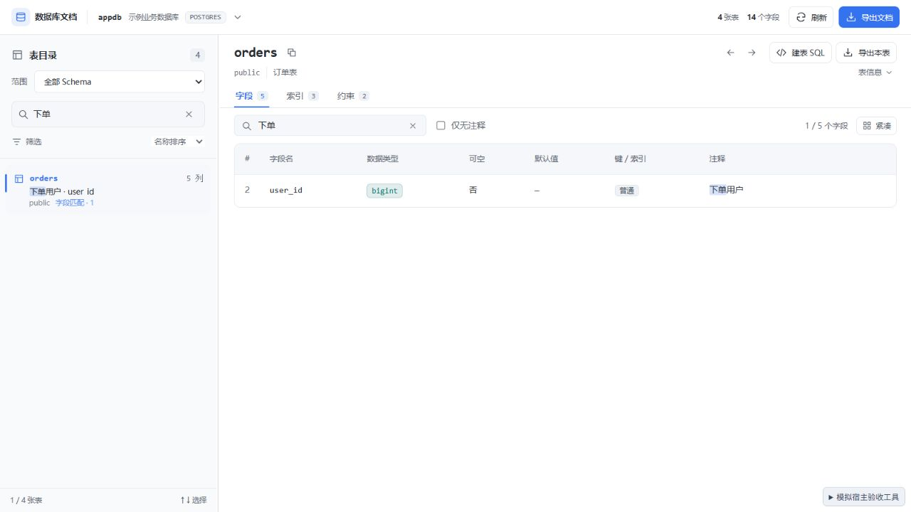
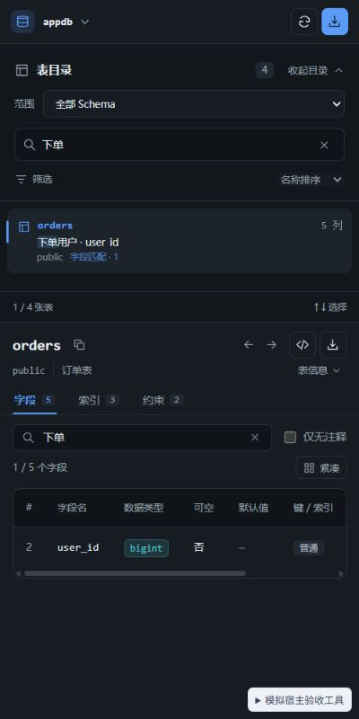

# 0.4.2 字段检索与高亮验收

日期：2026-10-09。目录普通搜索扩展为表名、表注释、Schema、字段名及字段注释；匹配内容在目录和字段详情中高亮。

## 行为

- 普通搜索默认查询字段元数据，移除单独的字段搜索开关。旧偏好中的 `fieldSearch: false` 不再关闭普通检索中的字段匹配。
- MySQL、PostgreSQL、SQL Server 搜索返回匹配字段名称与注释，按 Schema 和表名分组；含点号的标识符不会混淆分组。
- 目录沿用固定 72px 行，把匹配摘要放进原注释行，显示匹配数量。长注释显示命中附近片段，完整匹配文本可从悬浮提示读取。
- 点击或用方向键选择字段匹配结果后进入字段页，带入关键词，只展示匹配字段并高亮。点击已经选中的表也可重新定位；清空字段搜索恢复全部字段。
- 查询延迟 300ms，中文组合输入期间暂停派发；旧关键词、Schema、连接或数据库的结果失效。清空目录搜索恢复目录并聚焦输入。
- 正则仍只匹配本地表信息，界面说明范围；加载、失败和截断分别反馈，失败有原地重试入口。
- 同时补齐标准滚动条属性、现有连接名称表单的应用校验声明、导出预览固定尺寸，与项目 UI 规范保持一致。

## 浏览器模拟验收

使用本地 PostgreSQL 形态的模拟宿主，运行当前发行构建。

| 场景 | 结果 |
| --- | --- |
| 字段名 `user_id` | 自动找到 public.orders；目录字段名和详情字段名各有一个高亮，点击后显示 1 / 5 个字段 |
| 中文注释 `下单` | 摘要显示「下单用户 · user_id」；目录与字段注释同时高亮「下单」 |
| 清空恢复 | 清空字段搜索恢复 5 / 5 个字段；清空目录搜索恢复 4 / 4 张表并归还输入焦点 |
| 字段搜索失败 | 显示具体失败和「字段搜索未完成」，恢复模拟宿主后原地重试获得结果 |
| 旧查询晚到 | user_id 查询延迟 1.8 秒，期间改为 company；旧查询返回后仍仅显示 sales.customers 与 company 摘要 |
| 截断 | 保留匹配结果，显示缩小搜索范围提示 |
| Schema 与键盘 | created_at 在全部 Schema 匹配 3 张表；选择 sales 后只剩 sales.orders，方向键选择后详情为 1 / 4 个字段并高亮 created_at |
| 深色 / 窄窗口 | 400 × 800 下目录和字段命中都高亮；页面 clientWidth / scrollWidth 均为 400，字段表可独立横向滚动 |
| 大目录 | 1,204 张表时只渲染视口附近 12 行，未增加全量字段详情读取 |
| 正则 | orders$ 匹配两张跨 Schema 同名表并高亮；无效表达式显示具体错误 |
| 控制台 | 最终页面 error / warn 为空 |

## 自动检查与交付

| 检查 | 结果 |
| --- | --- |
| `npm run check` | 0 errors、0 warnings |
| `npm test -- --maxWorkers 1 --minWorkers 1` | 20 个文件、180 个用例通过 |
| `npm run build` | 成功，输出 DBX_UI_BUILD_SUCCESS |
| `node --check repro/mock-host.js` | 通过 |
| `git -c core.safecrlf=false diff --check` | 通过 |
| DESIGN.md lint | 0 errors；2 个颜色未被组件引用的提示，颜色仍由运行时 CSS 使用 |
| 严格 UI 静态审计 | 0 errors、0 warnings；见 ui-audit-0.4.2.json |
| `dbx-plugin package .` | 0.4.2 universal 未签名候选包 |
| 包验证 | artifact SHA-256 / 字节数、包内 5 个校验和、版本与当前源码 / 构建一致；见 package-verification-0.4.2.json |

候选包：`dist/com.sazs.dbdoc-0.4.2-universal.dbxp`，73,326 字节。SHA-256：`0292d820db2fb90fed08e95443d6ead633e10e73c68969a01ae7fb8608f64878`。

包内仅 manifest、图标、UI 和 checksums 共 6 个文件；入口引用 `index-Ds1R2fQB.js` 和 `index-BhnDrUne.css`。模拟宿主、设计文档、测试和截图不进入发行包。

静态审计范围为 `src/ui`。审计脚本扫描整个 `src` 时在 SQL 生成器的 TypeScript 解析中无法完成，因此按 UI 源码目录执行；业务逻辑另由 TypeScript 和单元测试检查。

本轮未安装至真实 DBX；MySQL / SQL Server 的 SQL 保持只读契约并通过现有方言回归，未进行真实数据库端执行。输入法组合事件的暂停逻辑已实现，本轮中文浏览器验证通过填入中文并离开输入框完成，未覆盖实体输入法组合事件。宿主单次字段查询最多 5,000 行，截断时数量代表已返回的命中。升级后关闭并重新打开数据库文档工作台。
