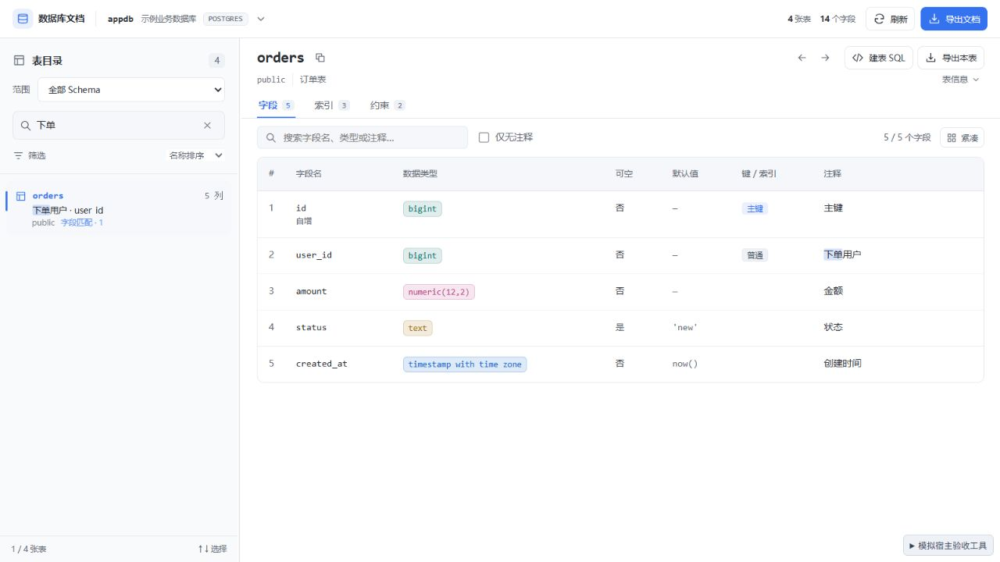

# 0.4.3 字段详情仅高亮验收

日期：2026-10-09。按用户最新要求，目录搜索关键词只参与字段详情高亮，不自动填入右侧筛选框。

- 打开字段匹配结果时展示全部字段，高亮匹配的字段名和注释。
- 右侧手动搜索独立控制筛选，优先高亮手动关键词；清空后恢复目录关键词高亮。
- 清空目录关键词后移除相关高亮，字段数量保持不变。
- 从索引页点击当前表的字段匹配结果，也能回到字段页；不新增重复浏览历史。

## 模拟宿主验证

| 场景 | 结果 |
| --- | --- |
| 左侧 user_id → 点击 orders | 右侧筛选框为空，5 / 5 个字段，user_id 高亮 |
| 左侧下单 → 点击 orders | 右侧筛选框为空，全部 5 个字段，注释中的「下单」高亮 |
| 手动搜索 amount，修改目录词为 user_id | 手动筛选仍为 amount，1 / 5 个字段，amount 高亮 |
| 清空手动筛选 | 恢复全部字段，重新高亮目录关键词 user_id |
| 清空目录关键词 | 5 个字段保持可见，相关高亮移除 |
| 索引页再次点击当前匹配表 | 返回字段页，全部字段和注释高亮可见 |
| 400 × 800 窄窗口 | 右侧输入为空、5 个字段保留，页面 clientWidth / scrollWidth 均为 400 |
| 控制台 | error / warn 为空 |

## 自动检查与交付

- Svelte / TypeScript：0 errors、0 warnings。
- Vitest：20 个文件、180 个用例通过。
- 构建成功，输出 DBX_UI_BUILD_SUCCESS。
- 严格 UI 静态审计：0 errors、0 warnings；见 ui-audit-0.4.3.json。
- DESIGN.md lint：0 errors，2 个已有的颜色引用提示。
- Git diff whitespace 检查通过。
- `dbx-plugin package .` 成功；0.4.3 universal 未签名候选包，73,294 字节。
- artifact SHA-256 / 字节数、包内 5 个校验和、版本及当前源码 / 构建一致；见 package-verification-0.4.3.json。

SHA-256：`445c5bc306e7ed946ea1a25e4498e004c8acf3f3de3977f3a3da4bf0739f6d4d`。

本轮使用本地模拟宿主验证，未安装至真实 DBX。此次字段页行为替代 0.4.2 的自动筛选行为；升级后关闭并重新打开工作台。
