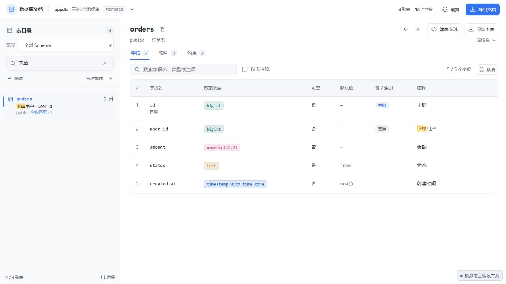
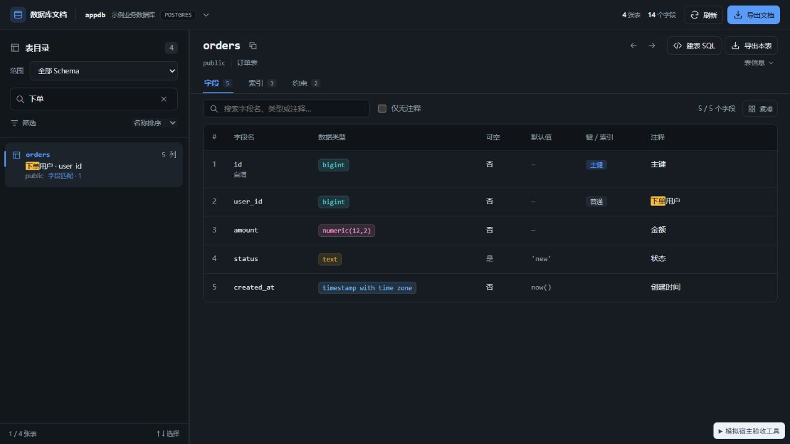

# 0.4.4 搜索高亮配色验收

日期：2026-10-09。搜索命中由低透明度主色混合，改为独立的实色暖黄色 / 琥珀色背景与深棕文字。

| 主题 | 背景 | 文字 | 文字与背景对比度 |
| --- | --- | --- | ---: |
| 浅色 | #ffe08a | #3d2900 | 10.74:1 |
| 深色 | #f2bd4d | #241800 | 10.09:1 |

浏览器模拟宿主已验证目录摘要与字段注释采用同一配色，实际 computed style 与上述值一致。字段页保持全部 5 个字段、右侧筛选框为空。400 × 800 窄窗口下页面 clientWidth / scrollWidth 均为 400。控制台 error / warn 为空。没有增加高亮的内边距或字重。

验证结果：

- Svelte / TypeScript 检查：0 errors、0 warnings。
- Vitest：20 个文件、180 个用例通过。
- 发行构建成功，输出 DBX_UI_BUILD_SUCCESS。
- 严格 UI 静态审计：0 errors、0 warnings；见 ui-audit-0.4.4.json。
- DESIGN.md lint：0 errors，2 个已有颜色引用提示。
- Git diff whitespace 检查通过。
- 0.4.4 universal 未签名候选包已生成；73,328 字节。
- 包 SHA-256、文件校验和、版本及当前源码 / 构建一致；见 package-verification-0.4.4.json。

SHA-256：`e043eaf9b1ae220026da849d1291250707859cc789d19a445ed68532cdc973ad`。

本轮使用本地模拟宿主，未安装至真实 DBX。宿主未提供主题时的系统深色分支同步采用同一深色配色，此分支本轮未单独模拟。
