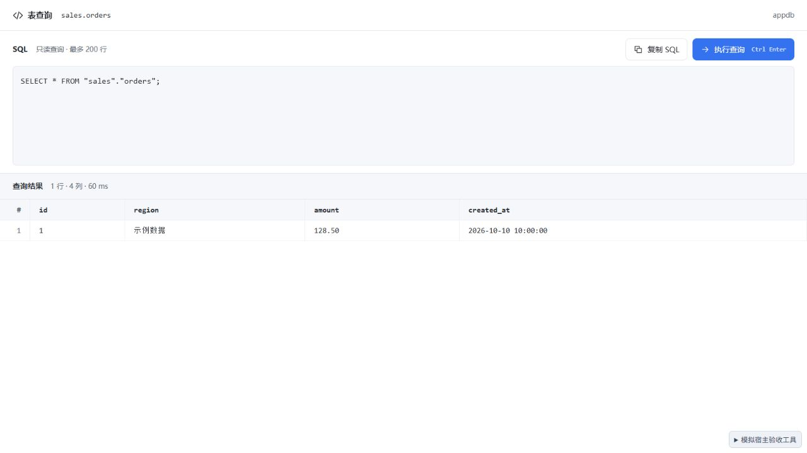
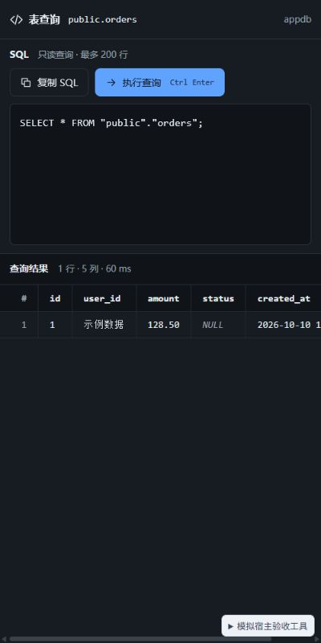

# 0.4.5 表目录双击查询验收

日期：2026-10-10。

目录单击仍查看文档；双击或目录获得焦点时按 Enter，通过官方 `openWorkbench` 新开本插件声明的「表查询」标签。默认 SQL 按数据库方言引用实际 Schema 和表名。打开查询页不执行 SQL，点击执行或在编辑器中按 Ctrl / ⌘ Enter 后才调用只读 `queryData`，最多 200 行。

## 接口边界

已核对 [官方插件文档](https://dbxio.com/cn/docs/plugin-development) 和 [宿主 bridge 实现](https://github.com/t8y2/dbx/blob/main/apps/desktop/src/lib/plugins/pluginHostBridge.ts)。`openWorkbench` 导航限于本插件的 workbench；`executeCommand` 限于本插件声明的 command。未找到打开原生 SQL 编辑器的插件接口，因此本轮使用独立插件查询页，并增加所需 `host.workbench` 权限。导航传入 `forceNew: true, target: 'tab'`，不通过未公开内部方法打开原生查询。

## 本地模拟宿主浏览器验收

- 单击 `sales.orders` 打开 4 个字段的表文档；双击后新开查询标签，原文档继续显示。默认 SQL 为 `SELECT * FROM "sales"."orders";`，刚打开时目录、详情、数据、探测和库列表查询计数均为 0。
- 手动 Ctrl Enter 执行一次后，结果显示 1 行、4 列，包含 `region`；随后从目录选择 `public.orders` 按 Enter，新开另一标签，默认 SQL 为 `SELECT * FROM "public"."orders";`。原查询编辑草稿独立保留。
- 修改 SQL 后结果标注来自上次查询；宿主仅更新连接名称时保留已编辑 SQL。执行 `WHERE 1 = 0` 后显示 0 行及「未查到记录」。
- SQL 复制走宿主剪贴板，显示已复制；会话关闭时显示打开数据库后重试的指引，恢复会话后可再次执行。截断结果有独立提示。
- 宿主缺少 `openWorkbench` 时，在目录显示升级提示；`dataApi` 为 false 时执行按钮禁用，并提示复制 SQL 到 DBX 执行。
- 深色主题实时切换；400 × 800 窄窗口根节点 clientWidth / scrollWidth 均为 400，宽结果在自身区域滚动，textarea computed resize 为 none。
- 原字段检索回归：目录搜索「下单」后仍显示全部 5 个字段，右侧字段筛选不继承目录关键词。

IAB 新开标签时记录了 `node:electron/js2c/sandbox_bundle` 的预加载错误；查询页渲染和上述操作完成，未观察到来自发行 UI 脚本的 error / warn。未安装到真实 DBX，本轮不代表真实宿主集成验收。

## 检查与候选包

- Svelte / TypeScript：0 errors、0 warnings。
- Vitest：21 个文件、195 个用例通过，覆盖三种方言的标识符转义、同名表定位、无自动执行的导航契约及宿主拒绝 / 不支持的处理。
- 发行构建成功，输出 DBX_UI_BUILD_SUCCESS。
- 严格 UI 静态审计：0 errors、0 warnings，见 ui-audit-0.4.5.json。
- DESIGN.md lint：0 errors，2 个已有颜色引用提示。
- Git diff whitespace 检查通过。
- universal 未签名候选包：76,943 字节；5 个包内校验和通过，manifest 与源文件语义一致，UI / 图标字节与当前构建一致。见 package-verification-0.4.5.json。

SHA-256：`3dea870dd1c181561c66bcfc35d84bc54a1a6131af4df01c038abf80a165c098`。
